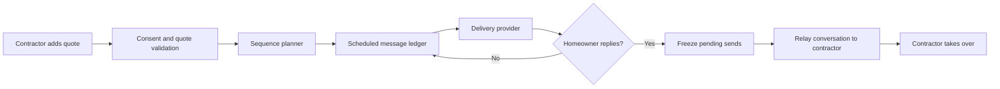

# ReKnock — System Design

## High-level flow

## Architectural principles

### The database is the source of truth for scheduled work

Each future message has a durable record with its timing, status, intent, and idempotency key. A worker can safely retry dispatch while preserving the rule that a canceled or frozen message must not be sent.

### Inbound events can invalidate outbound work

An inbound reply is not just a notification. It changes the state of the conversation and cancels pending automated work. The freeze operation is designed to be safe when it races with a dispatcher.

### Providers are replaceable edges

Twilio handles messaging, Resend handles email, Stripe handles billing, and Inngest handles orchestration. Business rules live above those providers so delivery mechanics do not define the product behavior.

### Human takeover remains obvious

The contractor can see the thread, receive the reply context, and respond from the same business identity. Future agent features must preserve the same takeover path.

## Reliability and safety controls

- idempotent message claims before sending
- status callbacks for delivery outcomes
- automatic STOP/HELP handling
- quiet-hour and pacing checks at send time
- hard cap on unanswered follow-ups
- audit events for sends, replies, freezes, and failures
- explicit separation between development and production environments

## Future extension: bounded agent assistance

The intended progression is conservative:

1. draft messages for human approval
2. answer narrowly scoped factual questions from known quote context
3. escalate negotiation, complaints, legal issues, and opt-outs
4. allow instant human takeover on any conversation

The system should earn autonomy through observable behavior rather than assuming that a general-purpose agent is safe by default.
